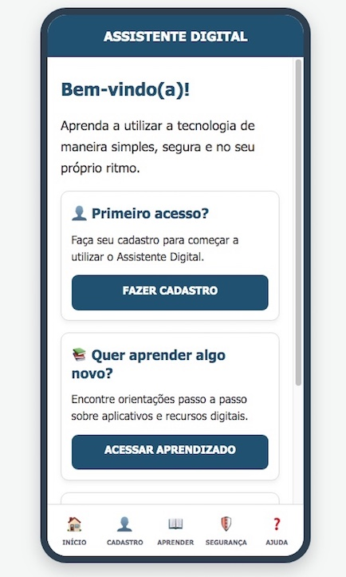
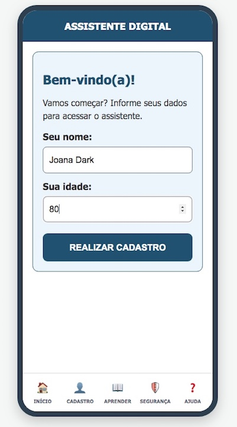
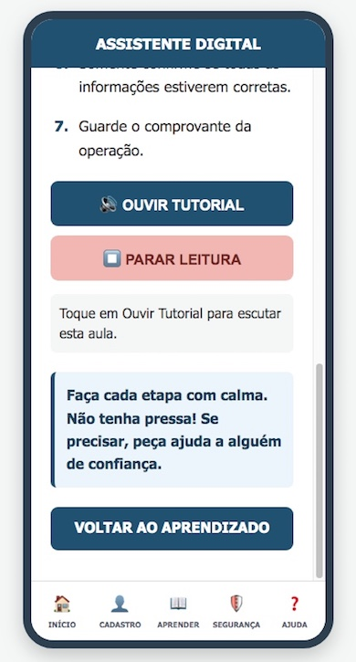
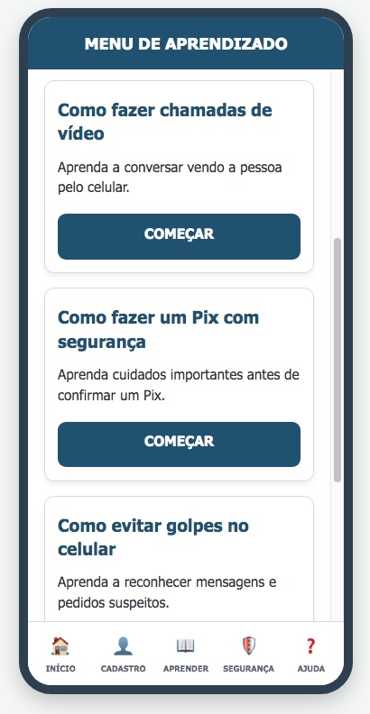
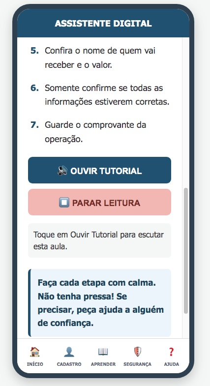
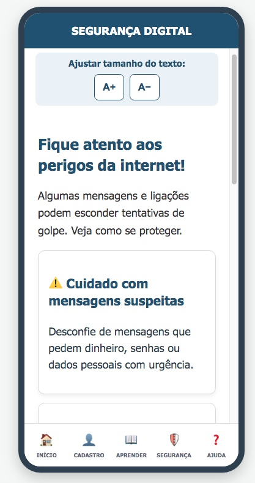
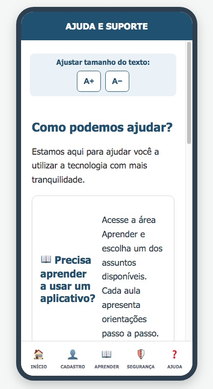
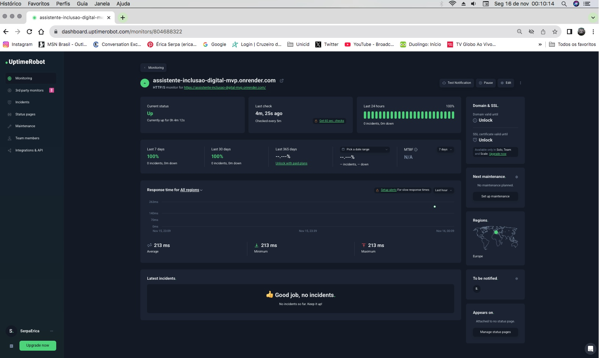

# Assistente de Inclusão Digital para Terceira Idade

MVP desenvolvido em **Python**, utilizando **Flask**, com o objetivo de apoiar pessoas idosas e iniciantes no uso de tecnologias digitais por meio de tutoriais guiados, orientações de segurança e recursos básicos de acessibilidade.

**Aplicação publicada:** https://assistente-inclusao-digital-mvp.onrender.com/

**Repositório:** https://github.com/EricaSerpa/assistente-inclusao-digital-mvp

---

## Sobre o projeto

O Assistente de Inclusão Digital para Terceira Idade surgiu da identificação de dificuldades enfrentadas por pessoas idosas ao utilizar smartphones, aplicativos e serviços digitais. Interfaces complexas, textos pequenos, termos técnicos e receio de cometer erros podem dificultar tarefas cotidianas e reduzir a autonomia dos usuários.

O MVP oferece uma aplicação web com navegação simplificada, cadastro, tutoriais passo a passo, orientações de segurança digital e uma área de ajuda. A proposta é apresentar informações de maneira clara e acolhedora, contribuindo para a aprendizagem e a inclusão digital.

## Objetivos

- Facilitar o acesso a orientações digitais para pessoas idosas.
- Apresentar tutoriais com linguagem simples e instruções organizadas.
- Reunir dicas de segurança para o uso cotidiano da internet.
- Oferecer recursos básicos de acessibilidade visual.
- Incentivar a autonomia e a confiança no uso da tecnologia.

## Funcionalidades implementadas

| Módulo | Descrição |
|---|---|
| Página inicial | Apresenta o assistente e permite iniciar a navegação. |
| Cadastro | Permite registrar informações básicas do usuário, com validação dos dados. |
| Menu de aprendizado | Organiza o acesso aos conteúdos disponíveis. |
| Tutoriais guiados | Disponibiliza orientações sobre WhatsApp, chamadas de vídeo, Pix, prevenção de golpes e navegação na internet. |
| Leitura em voz alta | Utiliza a síntese de voz disponível no navegador para ler o conteúdo do tutorial. |
| Segurança digital | Apresenta recomendações para reconhecer riscos e evitar golpes. |
| Ajuda | Reúne orientações para apoiar a utilização da aplicação. |
| Acessibilidade visual | Disponibiliza controles A+ e A− para ajustar o tamanho da fonte nas páginas de Segurança e Ajuda. |

## Tecnologias utilizadas

- **Python 3.10** — linguagem principal da aplicação.
- **Flask 3.1.3** — framework web utilizado para estruturar rotas e páginas.
- **SQLite / sqlite3** — banco de dados utilizado no armazenamento local.
- **HTML5** — estrutura das páginas.
- **CSS3** — estilos e apresentação visual.
- **JavaScript** — interações da interface e ajuste de fonte.
- **Síntese de voz do navegador** — leitura em voz alta dos tutoriais.
- **Git e GitHub** — controle de versão e hospedagem do código-fonte.
- **Render** — publicação da aplicação web.
- **UptimeRobot** — monitoramento de disponibilidade.

## Organização do projeto

A estrutura abaixo corresponde à organização da versão web:

```text
assistente-inclusao-digital-mvp/
├── main.py
├── cadastro.py
├── tutorial.py
├── acessibilidade.py
├── banco.py
├── test_mvp.py
├── requirements.txt
├── templates/
│   ├── index.html
│   ├── cadastro.html
│   ├── menu.html
│   ├── tutorial.html
│   ├── seguranca.html
│   └── ajuda.html
├── static/
│   └── style.css
├── imagem/
│   ├── tela-inicial.jpeg
│   ├── tela-cadastro.jpeg
│   ├── menu-aprendizado.jpeg
│   ├── lista-tutoriais.jpeg
│   ├── detalhe-tutorial.jpeg
│   ├── tela-seguranca.jpeg
│   ├── tela-ajuda.jpeg
│   └── uptimerobot-status.jpeg
└── .github/
    └── workflows/
        └── ci.yml
```

## Fluxo principal de utilização

1. O usuário acessa a página inicial da aplicação.
2. A partir da navegação, pode acessar o cadastro.
3. Após o cadastro, chega ao menu de aprendizado.
4. Escolhe um dos tutoriais disponíveis.
5. Consulta as instruções passo a passo e pode utilizar a leitura em voz alta do navegador.
6. Também pode acessar as páginas de Segurança e Ajuda.
7. Nas páginas de Segurança e Ajuda, pode ajustar o tamanho da fonte pelos controles A+ e A−.

## Telas da aplicação

As imagens abaixo representam capturas das telas da aplicação. Elas documentam a interface implementada no MVP.

## Telas da aplicação

As imagens abaixo representam capturas das telas da aplicação. Elas documentam a interface implementada no MVP.

### Tela inicial



### Cadastro



### Menu de aprendizado



### Lista de tutoriais



### Detalhe de um tutorial e leitura em voz alta



### Segurança digital



### Ajuda e acessibilidade



## Testes

O projeto possui testes automatizados no arquivo `test_mvp.py`, desenvolvidos com `unittest` e recursos de simulação de `unittest.mock`.

Para executar os testes a partir da pasta raiz do projeto:

```bash
python3 -m unittest -v test_mvp.py
```

Na execução documentada durante o desenvolvimento, foram aprovados **7 testes**, cobrindo fluxos relacionados ao cadastro, validação, tutoriais e persistência de dados. Recomenda-se executar novamente os testes no código atual para confirmar o resultado no ambiente utilizado.

O repositório também contém um fluxo de integração contínua em `.github/workflows/ci.yml`, configurado para executar os testes em atualizações e solicitações de integração direcionadas às branches `main` e `refactor/revisao-tecnica`.

## Publicação da aplicação

A aplicação foi publicada como um Web Service na plataforma Render.

- **URL pública:** https://assistente-inclusao-digital-mvp.onrender.com/
- **Ambiente:** Python 3.
- **Instalação das dependências:** `pip install -r requirements.txt`.
- **Comando de inicialização no Render:** `gunicorn main:app`.
- **Chave de sessão:** configurada como variável de ambiente `SECRET_KEY` no painel do Render.

> **Observação:** a implantação utiliza o plano gratuito do Render. Nesse plano, o sistema de arquivos local não deve ser considerado armazenamento persistente. Como o MVP utiliza SQLite localmente, os dados podem não ser preservados após reinicializações ou novas implantações. O banco de dados local não deve ser usado para armazenar dados reais ou sensíveis em produção.

## Monitoramento com UptimeRobot

Foi configurado um monitor HTTP/S para verificar a página pública da aplicação a cada cinco minutos.

Na captura registrada durante a etapa de acompanhamento, o painel apresentou:

- **Status:** UP.
- **Frequência de verificação:** a cada 5 minutos.
- **Disponibilidade exibida:** 100% nos períodos de 24 horas, 7 dias e 30 dias.
- **Incidentes registrados no painel naquele momento:** nenhum.

Esses números representam o painel no momento em que a evidência foi registrada; não constituem garantia de disponibilidade contínua.



## Validação com a comunidade

O MVP foi apresentado para avaliação de uma representante da comunidade, que apontou oportunidades de melhoria na leitura e na navegação. A partir das observações recebidas, foram realizados ajustes na interface e nos fluxos de utilização.

Entre as melhorias documentadas estão os controles de ampliação e redução da fonte nas páginas de Segurança e Ajuda e ajustes de validação e navegação. A validação com usuários é importante para verificar se a solução atende às necessidades reais do público.

## Relação com os Objetivos de Desenvolvimento Sustentável

O projeto está relacionado ao **ODS 10 – Redução das Desigualdades**, da Organização das Nações Unidas, por buscar reduzir barreiras de acesso e uso das tecnologias digitais por pessoas idosas.

A aplicação oferece recursos de aprendizagem e acessibilidade, mas o MVP ainda não possui contabilização persistente de todos os acessos e conclusões dos tutoriais. Por isso, não é possível afirmar que a meta planejada de interações foi numericamente alcançada.

## Limitações conhecidas e melhorias futuras

- Implementar registro de acessos e conclusões dos tutoriais para permitir medir a utilização.
- Ampliar as avaliações com pessoas da comunidade.
- Evoluir os recursos de acessibilidade e realizar testes de usabilidade.
- Avaliar uma solução de banco de dados persistente em nuvem para uma utilização de produção.
- Ampliar a cobertura dos testes automatizados.

## Como executar localmente

Execute os comandos a partir da pasta raiz do projeto.

### 1. Clonar o repositório

```bash
git clone https://github.com/EricaSerpa/assistente-inclusao-digital-mvp.git
cd assistente-inclusao-digital-mvp
```

Se a versão web estiver em uma branch específica, selecione a branch correspondente antes de executar a aplicação:

```bash
git switch refactor/revisao-tecnica
```

### 2. Criar e ativar um ambiente virtual

```bash
python3 -m venv venv
source venv/bin/activate
```

No Windows, a ativação pode ser feita com:

```powershell
venv\Scripts\activate
```

### 3. Instalar as dependências

```bash
python3 -m pip install -r requirements.txt
```

### 4. Iniciar a aplicação

```bash
python3 main.py
```

Depois, acesse no navegador o endereço local indicado pelo Flask, normalmente `http://127.0.0.1:5000/`.

Para iniciar com o servidor WSGI utilizado na publicação:

```bash
gunicorn main:app
```

## Licença

Nenhuma licença de uso foi declarada neste repositório. Consulte a responsável pelo projeto antes de reutilizar ou redistribuir o código.

---

**Projeto acadêmico — Curso Superior de Tecnologia em Análise e Desenvolvimento de Sistemas.**

